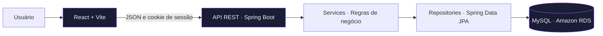

<div align="center">


# Qualiflow

**Controle de qualidade de garrafas PET de 2 litros**

Da inspeção ao painel, acompanhe a conformidade da produção com dados reais.


[Conheça o projeto](#sobre-o-projeto) · [Funcionalidades](#funcionalidades) · [Executar localmente](#executar-localmente) · [API](#api) · [Equipe](#equipe)

</div>

---

> **Versão integrada**
> O frontend React e o backend conectados estão na branch [`integracao`](https://github.com/victorrmorenoo/qualiflow/tree/integracao). As instruções e funcionalidades abaixo se referem a essa versão.

## Sobre o projeto

O Qualiflow é uma plataforma web para acompanhar inspeções de garrafas PET de 2 litros. O painel reúne indicadores de qualidade, histórico das medições e uma estimativa do custo do material das amostras inspecionadas.

Desenvolvido como **Projeto Integrador do 2º semestre de Análise e Desenvolvimento de Sistemas**, o sistema atende ao cenário da empresa fictícia **Insight Manufacturing Group**, do setor de transformação de polímeros.

A base de referência contém **5.000 registros de inspeção**, com horário, linha de sopro, turno, classificação e medidas físicas de cada garrafa.

## Funcionalidades

| Área | O que você pode fazer |
| --- | --- |
| **Acesso** | Entrar com e-mail e senha, recuperar a sessão ao atualizar a página e fazer logout |
| **Gestão de contas** | Cadastrar funcionários e gestores por uma conta com cargo de gestor |
| **Filtros** | Combinar período, turno, linha de produção e conformidade |
| **Indicadores** | Consultar quantidade de garrafas, conformidade, atenção e reprovação |
| **Medições** | Alternar a medida exibida no gráfico e na tabela |
| **Histórico** | Visualizar um ponto por garrafa e consultar as 12 inspeções mais recentes do recorte |
| **Relatórios** | Acompanhar contagens e percentuais do resultado filtrado |
| **Material** | Estimar o custo do PET inspecionado e desperdiçado com um preço por kg editável |
| **Interface** | Usar o painel em desktop e celular, com tabelas de rolagem horizontal |

### Medições disponíveis no gráfico

- Massa, em gramas.
- Espessura do corpo e do ombro, em milímetros.
- Diâmetro do gargalo e altura, em milímetros.
- Volume útil, em mililitros.

O gráfico preserva todas as medições na linha e reduz os marcadores visíveis em intervalos extensos. As cores dos pontos seguem o status geral da garrafa. As faixas de aceitação configuradas no frontend vieram do protótipo e estão sujeitas à validação da equipe.

### Classificações

| Valor da API | Apresentação no painel |
| --- | --- |
| `Conforme` | Conforme |
| `Revisao` | Atenção |
| `Reprovado` | Fora do padrão |

### Como a estimativa de material funciona

```text
Massa inspecionada em kg = soma de massa_g ÷ 1.000
Custo estimado = massa inspecionada em kg × preço por kg
Custo desperdiçado = massa das garrafas Reprovado em kg × preço por kg
```

Pela regra adotada no projeto, toda garrafa `Reprovado` é considerada descartada. O desperdício já está incluído no custo total estimado do recorte. Os valores representam as garrafas inspecionadas e acompanham os filtros da tela.

## Arquitetura



O backend organiza as requisições em **controllers**, as regras em **services** e o acesso ao banco em **repositories**. Os DTOs definem os dados de entrada e de resposta das contas.

O login usa uma sessão HTTP identificada pelo cookie `JSESSIONID`. As senhas são armazenadas com hash por meio do módulo `spring-security-crypto`. O cadastro verifica o cargo de gestor no backend.

## Estrutura do repositório

Estrutura da branch `integracao`:

```text
qualiflow/
├── BackEnd/
│   └── qualiflow/
│       ├── pom.xml
│       └── src/main/
│           ├── java/com/senai/projeto/
│           │   ├── config/
│           │   ├── controller/
│           │   ├── dto/
│           │   ├── enums/
│           │   ├── model/
│           │   ├── repository/
│           │   └── service/
│           └── resources/
└── FrontEnd/
    ├── public/
    ├── src/
    │   ├── components/
    │   ├── services/api.js
    │   └── App.jsx
    ├── package.json
    └── vite.config.js
```

## Executar localmente

Você precisa de um **JDK compatível com Java 17**, **Node.js compatível com o Vite 8**, npm e acesso ao banco MySQL povoado usado pelo projeto.

### 1. Obter a versão integrada

```bash
git clone --branch integracao https://github.com/victorrmorenoo/qualiflow.git
cd qualiflow
```

### 2. Iniciar o backend

Configure os dados da sua conexão MySQL por variáveis de ambiente. No PowerShell:

```powershell
cd BackEnd/qualiflow

$env:SPRING_DATASOURCE_URL = "jdbc:mysql://SEU_HOST:3306/qualiflow"
$env:SPRING_DATASOURCE_USERNAME = "SEU_USUARIO"
$env:SPRING_DATASOURCE_PASSWORD = "SUA_SENHA"

.\mvnw.cmd spring-boot:run
```

A API deve iniciar em `http://localhost:8080`. Para o fluxo de cadastro, é necessária uma primeira conta gestora no banco com senha gerada pelo mesmo encoder do backend.

### 3. Iniciar o frontend

Em outro terminal, na pasta `FrontEnd`:

```bash
npm ci
npm run dev
```

Crie ou confira o arquivo `.env.development`:

```dotenv
VITE_API_URL=/api
```

Abra **http://localhost:5173**. O proxy do Vite encaminha `/api/*` ao backend local e remove o prefixo antes de enviar a requisição. As chamadas de conta incluem o cookie de sessão.

### 4. Gerar o build

```bash
npm run build
```

Os arquivos de publicação são gerados em `FrontEnd/dist`.

## API

Rotas do backend, sem o prefixo do proxy:

| Método | Rota | Finalidade |
| --- | --- | --- |
| `POST` | `/login` | Autenticar e criar sessão |
| `GET` | `/usuarios/me` | Recuperar dados públicos da conta logada |
| `POST` | `/usuarios` | Cadastrar uma conta, mediante sessão de gestor |
| `POST` | `/logout` | Encerrar a sessão |
| `GET` | `/garrafas` | Consultar inspeções com filtros opcionais |
| `GET` | `/garrafas/{id}` | Consultar uma inspeção pelo identificador |

<details>
<summary><strong>Consultar parâmetros e exemplos de filtros</strong></summary>

| Parâmetro | Valores |
| --- | --- |
| `periodo` | `HOJE`, `ULTIMOS_7_DIAS`, `ULTIMOS_30_DIAS`, `PERSONALIZADO` |
| `turno` | `Manhã`, `Tarde`, `Noite` |
| `linha` | `Sopro_01`, `Sopro_02`, `Sopro_03`, `Sopro_04` |
| `status` | `Conforme`, `Revisao`, `Reprovado` |
| `dataInicio` e `dataFim` | Datas no formato `AAAA-MM-DD`, exigidas no período personalizado |

Os períodos rápidos incluem hoje. O intervalo personalizado inclui os dois dias selecionados. Filtros omitidos permitem todas as opções daquele campo, e os filtros enviados são combinados por **E**.

```http
GET /garrafas?linha=Sopro_01&turno=Tarde&status=Reprovado
```

```http
GET /garrafas?periodo=PERSONALIZADO&dataInicio=2026-02-01&dataFim=2026-02-10
```

Uma consulta válida retorna `200` com uma lista JSON, inclusive vazia. Um período personalizado com data ausente ou invertida retorna `400`.

</details>

## Publicação na AWS

| Componente | Destino | Etapa |
| --- | --- | --- |
| Banco MySQL | Amazon RDS | Conexão e leitura verificadas durante o desenvolvimento |
| API Spring Boot | Amazon EC2 | Publicação planejada |
| Frontend React | Amazon S3 | Hospedagem definida |
| HTTPS e encaminhamento de `/api` | Amazon CloudFront | Configuração proposta para a publicação |

O proxy do Vite atende ao desenvolvimento. A publicação precisa configurar o encaminhamento de `/api`, incluindo os cookies da sessão.

## Equipe

| Integrante | Área |
| --- | --- |
| **Karen Tibério** | Cloud |
| **Luana Canto** | DevOps e Ciência de Dados |
| **Steffany Camargo** | Frontend |
| **Victor Moreno** | Backend |

---

<div align="center">
<strong>Qualiflow</strong><br>
Projeto Integrador · Análise e Desenvolvimento de Sistemas
</div>
